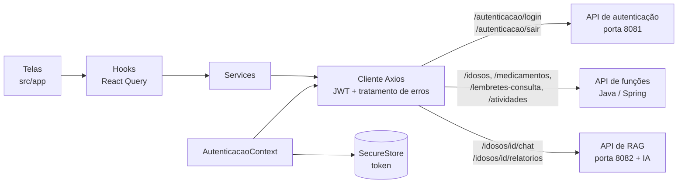

# Ajudante Familiar (app mobile)

> **Global Solution 2026/2 · CitizenTech** · FIAP · 2º ano de Análise e Desenvolvimento de Sistemas
> Disciplina: **Mobile Application Development** (React Native + Expo)

Aplicativo para quem cuida de uma pessoa idosa. O cuidador registra medicamentos, consultas, atividades e as informações de saúde do idoso. A família acompanha tudo pelo próprio celular, em modo somente leitura.

## Integrantes

| RM       | Nome completo                        |
| -------- | ------------------------------------ |
| RM561551 | Gabriel Fachin de Oliveira           |
| RM566482 | Fernando Charlles Faustino Fernandes |
| RM565708 | Iago D. Ainette                      |
| RM565799 | Leticia Santiago                     |

## Links

|                                   |                                                                                     |
| --------------------------------- | ----------------------------------------------------------------------------------- |
| Vídeo de demonstração (até 5 min) | _colar o link do YouTube aqui_                                                      |
| Firebase App Distribution         | _colar o link de convite aqui_                                                      |
| API de funções (Java/Spring)      | [CitieZen-GS/API-Funcoes](https://github.com/CitieZen-GS/API-Funcoes)               |
| API de autenticação (Java/Spring) | [CitieZen-GS/API-autentificador](https://github.com/CitieZen-GS/API-autentificador) |
| API de RAG (Java/Spring + IA)     | [CitieZen-GS/RAG](https://github.com/CitieZen-GS/RAG)                               |

---

## O problema e quem se beneficia

O Brasil tem mais de 32 milhões de pessoas com 60 anos ou mais (IBGE, Censo 2022). Boa parte delas é cuidada por familiares ou cuidadores que fazem malabarismo com horários de remédios, consultas e rotina, quase sempre em anotações de papel ou mensagens soltas. Remédios esquecidos e consultas perdidas são comuns, e a família que mora longe não sabe como o idoso está.

- **Cuidador(a)**: organiza a rotina em um só lugar.
- **Familiar**: acompanha em tempo real, sem precisar ligar para perguntar.
- **Idoso(a)**: recebe um cuidado mais seguro e contínuo.

**ODS relacionados:** 3 (Saúde e bem-estar), 10 (Redução das desigualdades) e 11 (Cidades e comunidades sustentáveis).

## Funcionalidades

| Perfil       | O que pode fazer                                                                                                                                                                                                                                                                                   |
| ------------ | -------------------------------------------------------------------------------------------------------------------------------------------------------------------------------------------------------------------------------------------------------------------------------------------------- |
| **Cuidador** | Criar a própria conta e o acesso dos familiares; cadastrar, editar e excluir idosos, medicamentos, consultas e atividades; marcar consulta como realizada; separar os remédios que devem ir para a consulta; conversar com o assistente de IA sobre a rotina do idoso; gerar relatórios do período |
| **Familiar** | Entrar com o acesso criado pelo cuidador e ver o resumo do dia, os remédios, as consultas, as atividades e a ficha do idoso (somente leitura)                                                                                                                                                      |

O **cuidador é o dono da conta**: ele se cadastra, cadastra os idosos e cria o acesso de cada familiar a um idoso específico. Não existe cadastro público de familiar. O controle de acesso é feito pela API (o JWT traz a claim `roles`). O app também esconde os botões de edição para o familiar, e as telas do assistente e dos relatórios ficam numa rota protegida (`Stack.Protected`) que só existe para o cuidador.

## Telas (17, além da "Sobre o App")

| #   | Tela                                               | Rota                  | Requisito      |
| --- | -------------------------------------------------- | --------------------- | -------------- |
| 1   | Login                                              | `/login`              | Autenticação   |
| 2   | Cadastro do cuidador                               | `/cadastro`           | Autenticação   |
| 3   | Início: resumo do dia                              | `/` (aba)             | CRUD (leitura) |
| 4   | Remédios: lista                                    | `/medicamentos` (aba) | CRUD           |
| 5   | Consultas: lista com filtro e status               | `/consultas` (aba)    | CRUD           |
| 6   | Atividades: lista com filtro por dia               | `/atividades` (aba)   | CRUD           |
| 7   | Perfil e logout                                    | `/perfil` (aba)       | Autenticação   |
| 8   | Meus idosos                                        | `/idosos`             | CRUD           |
| 9   | Ficha do idoso (criar/editar/excluir)              | `/idosos/[id]`        | CRUD           |
| 10  | Medicamento (criar/editar/excluir)                 | `/medicamento/[id]`   | CRUD           |
| 11  | Consulta (criar/editar/excluir + remédios a levar) | `/consulta/[id]`      | CRUD           |
| 12  | Atividade (criar/editar/excluir)                   | `/atividade/[id]`     | CRUD           |
| 13  | Assistente: chat com IA sobre a rotina (cuidador)  | `/assistente`         | API de RAG     |
| 14  | Relatórios: lista com situação da geração          | `/relatorios`         | API de RAG     |
| 15  | Novo relatório (assunto, período e pedido à IA)    | `/relatorios/novo`    | API de RAG     |
| 16  | Relatório (leitura e exclusão)                     | `/relatorios/[id]`    | API de RAG     |
| 17  | Cadastrar familiar (acesso a um idoso, cuidador)   | `/familiar/novo`      | Autenticação   |
| –   | Sobre o App (hash do commit)                       | `/sobre`              | Publicação     |

## Tecnologias e justificativas

| Biblioteca                                    | Para quê                 | Por que ela                                                                      |
| --------------------------------------------- | ------------------------ | -------------------------------------------------------------------------------- |
| **Expo SDK 58** + React Native 0.88           | Base do app              | Recomendado pela documentação do React Native; build na nuvem sem Android Studio |
| **Expo Router**                               | Navegação (Stack + Tabs) | Rotas por arquivo e `Stack.Protected` para rotas protegidas                      |
| **Axios**                                     | Consumo da API REST      | Interceptors para enviar o JWT e tratar o 401 em um só lugar                     |
| **TanStack React Query**                      | Estado do servidor       | Cache, loading/erro prontos e atualização das listas após salvar                 |
| **expo-secure-store**                         | Guardar o token          | Usa o Keystore/Keychain do aparelho, que é criptografado (AsyncStorage não é)    |
| **@expo-google-fonts/nunito** + **expo-font** | Fonte personalizada      | Nunito é arredondada e muito legível em tamanhos grandes                         |
| **@expo/vector-icons** (Ionicons)             | Ícones                   | Já vem com o Expo, sem dependência extra                                         |
| **expo-splash-screen**                        | Splash                   | Mantém a splash até carregar as fontes e a sessão salva                          |
| ESLint (`eslint-config-expo`) + Prettier      | Padronização do código   | `npm run lint` e `npm run format`                                                |

## Arquitetura e organização

```
src/
├── app/                      # Rotas (Expo Router) — cada arquivo é uma tela
│   ├── _layout.tsx           # Providers + guard de autenticação (Stack.Protected)
│   ├── (auth)/               # Telas públicas: login, cadastro
│   └── (app)/                # Telas protegidas (só com sessão)
│       ├── (abas)/           # Barra inferior: início, remédios, consultas, atividades, perfil
│       ├── idosos/           # Lista e ficha do idoso
│       ├── medicamento/[id]  # Formulários (id = "novo" para criar)
│       ├── consulta/[id]
│       ├── atividade/[id]
│       ├── assistente.tsx    # Chat com a IA (só cuidador)
│       ├── relatorios/       # Lista, novo e leitura de relatórios (só cuidador)
│       └── sobre.tsx
├── components/               # Componentes visuais
│   ├── comuns/               # Botao, CampoTexto, Cartao, Tela, TelaLista, TextoMarkdown, estados...
│   └── <domínio>/            # Cartões de idoso, medicamento, consulta, atividade, relatório; balões do chat
├── contexts/                 # Autenticação, idoso selecionado, tema claro/escuro
├── hooks/                    # React Query por recurso + useFormulario
├── services/                 # Acesso à API (Axios), autenticação, armazenamento seguro
├── styles/tema.ts            # Cores, fontes, tamanhos e espaçamentos
├── types/                    # Tipos espelhando os DTOs da API Java
└── utils/                    # Formatação (datas, máscaras) e validações
assets/                       # Ícone, splash e logo próprios
```

Uma requisição percorre as camadas assim: **tela → hook (React Query) → service → cliente Axios → API**. As telas não chamam o Axios diretamente.



### Fluxo de autenticação

1. Login ou cadastro chama a API de autenticação, que devolve o JWT (`tokenAcesso`) e o `tokenAtualizacao`.
2. O token é salvo no **SecureStore** e enviado em `Authorization: Bearer` por um interceptor do Axios.
3. O layout raiz usa `Stack.Protected`: sem sessão só existem as telas `(auth)`; com sessão, só as `(app)`.
4. **Logout** revoga o token de atualização na API (`/autenticacao/sair`), apaga a sessão e o cache, e o guard leva automaticamente ao login.
5. Se a API responder **401** (token expirado), a sessão é encerrada do mesmo jeito.

### Tratamento de erros e feedback visual

- `extrairMensagemErro` converte a `ErroResposta` da API (400 com campos, 403, 404, 409, 422, 5xx, sem internet, timeout) em mensagens claras.
- Todas as listas têm estados de **carregando**, **erro com "tentar novamente"**, **lista vazia** e **puxar para atualizar**.
- Os formulários validam antes de enviar, com as mesmas regras do Bean Validation da API, e mostram indicador de carregamento no botão.
- Exclusões pedem confirmação.

### Acessibilidade e usabilidade

- Texto base de 17 pt, área de toque mínima de 52 pt e alto contraste.
- Tema claro e escuro, seguindo o sistema.
- `accessibilityRole`, `accessibilityLabel` e `accessibilityState` em botões, campos, opções e alertas.
- Máscaras de data, hora, CPF e telefone, com teclado numérico.

## Integração com a API

**API de funções** ([API-Funcoes](https://github.com/CitieZen-GS/API-Funcoes)), todas as rotas com `Bearer <jwt>`:

| Recurso      | Endpoints usados no app                                                                                                                                                                                        |
| ------------ | -------------------------------------------------------------------------------------------------------------------------------------------------------------------------------------------------------------- |
| Idosos       | `GET /idosos?idCuidador=` · `GET/PUT/DELETE /idosos/{id}` · `POST /idosos` · `GET /idosos/{id}/resumo?data=`                                                                                                   |
| Medicamentos | `GET/POST /idosos/{id}/medicamentos` · `GET/PUT/DELETE /medicamentos/{id}`                                                                                                                                     |
| Consultas    | `GET/POST /idosos/{id}/lembretes-consulta?status=` · `GET/PUT/DELETE /lembretes-consulta/{id}` · `PATCH /lembretes-consulta/{id}/status` · `POST/DELETE /lembretes-consulta/{id}/medicamentos/{idMedicamento}` |
| Atividades   | `GET/POST /idosos/{id}/atividades?data=` · `GET/PUT/DELETE /atividades/{id}`                                                                                                                                   |

**API de autenticação** ([API-autentificador](https://github.com/CitieZen-GS/API-autentificador), porta 8081):

| Endpoint                               | Uso no app                                                                                                                                 |
| -------------------------------------- | ------------------------------------------------------------------------------------------------------------------------------------------ |
| `POST /autenticacao/login`             | Tela de login. Cuidador recebe `tipo: CUIDADOR`; parente recebe `tipo: FAMILIAR` e o `idIdoso` que acompanha                               |
| `POST /autenticacao/sair`              | Logout: revoga o token de atualização antes de apagar a sessão do aparelho                                                                 |
| `POST /autenticacao/cadastro/cuidador` | Tela de cadastro (pública). Devolve a mesma `TokenResposta` do login, então o cuidador já entra logado                                     |
| `POST /autenticacao/cadastro/parente`  | Tela "Cadastrar familiar" (só cuidador logado, para um idoso dele). Devolve o `UsuarioResposta` do familiar; a sessão do cuidador não muda |

```http
POST /autenticacao/login
{ "email": "ana@email.com", "senha": "123456" }

200 OK
{
  "tokenAcesso": "<jwt>",
  "tipoToken": "Bearer",
  "expiraEm": 3600,
  "tokenAtualizacao": "<token opaco>",
  "usuario": { "id": 1, "nome": "Ana", "email": "ana@email.com", "tipo": "CUIDADOR", "permissoes": ["LEITURA", "ESCRITA"], "idIdoso": null }
}
```

```http
POST /autenticacao/cadastro/cuidador          (pública, 201 + TokenResposta)
{ "nome": "Ana", "cpf": "123.456.789-00", "email": "ana@email.com", "senha": "123456" }

POST /autenticacao/cadastro/parente            (Bearer do cuidador, 201 + UsuarioResposta)
{ "nome": "João", "telefone": "(11) 98765-4321", "email": "joao@email.com", "senha": "123456", "idIdoso": 3 }
```

O `tokenAcesso` é um JWT HS256 assinado com o mesmo segredo da API de funções (claim `roles`: `CUIDADOR` ou `FAMILIAR`). O app o envia em `Authorization: Bearer` e guarda a sessão no SecureStore.

**API de RAG** ([RAG](https://github.com/CitieZen-GS/RAG), porta 8082): chat e relatórios com IA sobre os registros do idoso. Usa o mesmo JWT e só atende o **cuidador** (familiar recebe 403), e só para os idosos dele.

| Endpoint                                       | Uso no app                                                                                   |
| ---------------------------------------------- | -------------------------------------------------------------------------------------------- |
| `GET /idosos/{id}/chat?limite=100`             | Histórico da conversa na tela Assistente                                                     |
| `POST /idosos/{id}/chat`                       | Envia a pergunta; a resposta traz o `periodoConsultado`, mostrado embaixo da última resposta |
| `DELETE /idosos/{id}/chat`                     | Botão "Apagar conversa" (a memória da IA recomeça)                                           |
| `GET /idosos/{id}/relatorios`                  | Lista de relatórios (sem o conteúdo)                                                         |
| `POST /idosos/{id}/relatorios`                 | Pede o relatório: responde **202** com status `GERANDO` e o app abre a tela do relatório     |
| `GET /idosos/{id}/relatorios/{idRelatorio}`    | Lê o relatório em Markdown. Enquanto estiver `GERANDO`, o app consulta de novo a cada 3 s    |
| `DELETE /idosos/{id}/relatorios/{idRelatorio}` | Exclui o relatório                                                                           |

Como o app lida com a IA:

- O cliente Axios da API de RAG tem tempo limite de 60 s, porque a resposta passa pela IA. As outras APIs continuam com 15 s.
- A geração do relatório é assíncrona (RabbitMQ no backend). O app acompanha o status com o `refetchInterval` do React Query, que para sozinho quando o relatório fica `CONCLUIDO` ou `ERRO`. Com `ERRO`, a tela oferece "Pedir novamente".
- As respostas e os relatórios vêm em Markdown. O componente `TextoMarkdown` mostra títulos, listas, negrito e tabelas simples usando só o `Texto` do app, sem biblioteca extra.
- O formulário de relatório valida as mesmas regras da API antes de enviar: datas válidas, fim depois do início e no máximo 90 dias.
- O erro **503** (a IA não respondeu) mostra a mensagem da própria API. No chat, a pergunta volta para o campo para o usuário tentar de novo.

## Como executar

Pré-requisitos: Node 20 ou superior e o app **Expo Go** no celular (ou um emulador Android).

```bash
npm install
cp .env.example .env      # preencha EXPO_PUBLIC_API_URL, EXPO_PUBLIC_AUTH_URL e EXPO_PUBLIC_RAG_URL
npx expo start            # leia o QR code com o Expo Go
```

| Comando             | O que faz                               |
| ------------------- | --------------------------------------- |
| `npm run android`   | Abre no emulador Android                |
| `npm run web`       | Abre no navegador (para testes rápidos) |
| `npm run lint`      | ESLint                                  |
| `npm run typecheck` | TypeScript (`tsc --noEmit`)             |
| `npm run format`    | Prettier                                |

> Sem `.env`, o app usa `http://10.0.2.2:8080` (funções), `http://10.0.2.2:8081` (autenticação) e `http://10.0.2.2:8082` (RAG): no emulador Android, `10.0.2.2` é o `localhost` do computador. No celular físico, use o IP do PC na rede (ex.: `http://192.168.0.10:8080`).

## Publicação (Firebase App Distribution)

1. Crie as variáveis `EXPO_PUBLIC_API_URL`, `EXPO_PUBLIC_AUTH_URL` e `EXPO_PUBLIC_RAG_URL` no ambiente **preview** do projeto no Expo (ou com `npx eas-cli@latest env:create`).
2. Gere o APK na nuvem: `npx eas-cli@latest build -p android --profile preview`.
3. No [Firebase Console](https://console.firebase.google.com/) → **App Distribution**, crie o app Android com o pacote `br.com.citiezen.ajudantefamiliar`, envie o `.apk` e adicione o **e-mail do professor como tester**.
4. Abra **Perfil → Sobre o App** no aparelho e confira se o **hash do commit** é o mesmo do último commit da `main`.

O hash vem do `app.config.ts`: no build em nuvem ele usa `EAS_BUILD_GIT_COMMIT_HASH`; localmente, `git rev-parse HEAD`.

## Declaração de uso de IA generativa

| Ferramenta                          | Para quê                                                                                                                                                   |
| ----------------------------------- | ---------------------------------------------------------------------------------------------------------------------------------------------------------- |
| Claude (Anthropic), via Claude Code | Apoio na estruturação inicial do projeto, sugestões de código para telas, serviços e componentes, revisão de padrões do Expo SDK 58 e redação deste README |

Todo o código foi revisado, testado e é compreendido pela equipe, que se responsabiliza pelas decisões técnicas apresentadas.
